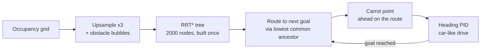
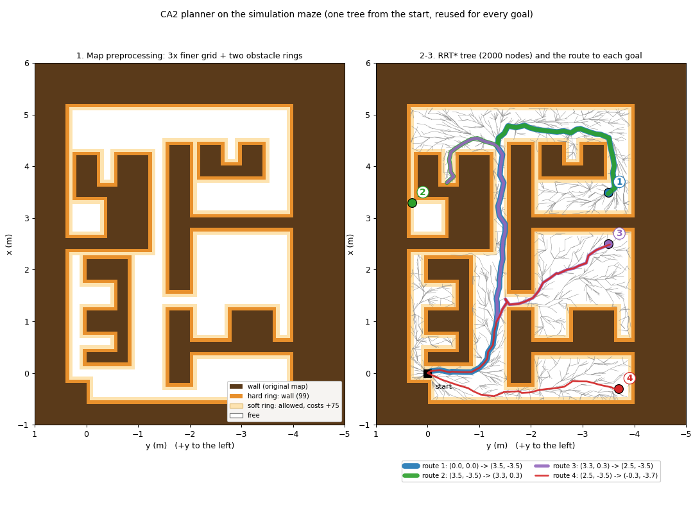
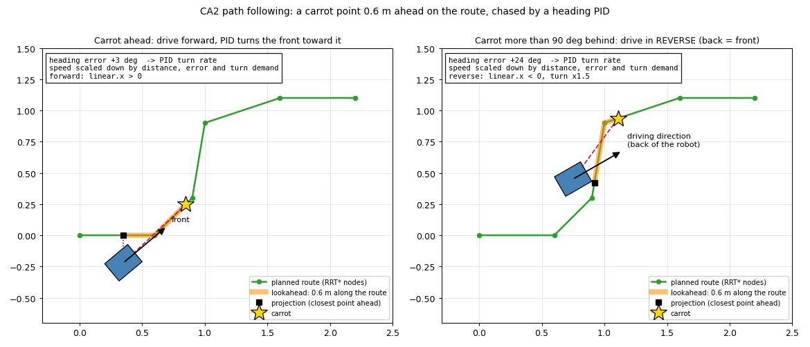

# CA2: Path Planning

Paths on this page are relative to the ROS workspace, the `rb2301/` folder of this repo.

The robot has to drive through a known maze and reach a list of goal points in order, without touching a wall. Our solution plans every route with **RRT\*** on an inflated, higher-resolution copy of the occupancy grid. It then follows each route with a **carrot point** and a **heading PID**, driving like a car: forward, reverse and turning only, with no sideways motion (the bonus requirement).

- Package: `src/rb2301_ca2`
- All our code is in `src/rb2301_ca2/rb2301_ca2/path_planning.py`: `WaypointNode.timer_callback()` (between the `INSERT CODE HERE` markers), the controller variables in `__init__()`, `preprocess_map()`, `get_carrot_target()`, and the `TreeNode` and `Tree` classes.
- The same file runs in Gazebo and on the real maze (`--run test1 | test2 | full`).

## How it works



### 1. Map preprocessing (`preprocess_map`)

- The 0.2 m grid is upsampled 3 times, to 0.067 m cells, so the walls can be inflated by less than a whole original cell.
- **Hard ring:** every free fine cell next to a wall becomes a wall (99).
- **Soft ring:** every free fine cell next to that becomes 75. It can still be crossed, but every node placed there costs extra, so routes keep away from walls when they have room.

### 2. RRT\* (built once, on the first control step)

The tree grows from the robot's start pose until it has 2,000 nodes:

1. Sample a random point anywhere in the map.
2. Find the nearest tree node and step toward the sample by at most 0.2 m in x and in y. A box limit is cheaper than a circle.
3. Reject the step if the segment crosses a hard wall. The segment is checked at half-cell intervals (`line_intersects_obstacle`).
4. Cost of the new node = parent cost + segment length + the cell cost at the node (0 free, 75 in the soft ring).
5. **Rewire (RRT\*):** within 0.2 m, give the new node the cheapest collision-free parent. Then re-parent any nearby node that would be cheaper through the new node, and update the costs of its descendants.

Nodes are also inserted into a k-d tree structure, but the nearest-node search is still a linear scan.

### 3. Route to each goal (`path_to_goal`)

One tree serves every goal. For goal *k*, the start is the tree node nearest the previous goal (the root for the first goal), and the end is the node nearest goal *k*. The route goes up from the start to the **lowest common ancestor** of the two nodes, then down to the goal. That way the robot never has to return to the root.



*Drawn like the code's `print_map()`: +x up, +y to the left. Left: the inflated planning map; the robot may enter the soft ring (it just costs more), never the hard ring. Right: one seeded run of the real planner code (`media/ca2/make_ca2_media.py`), the 2,000-node tree and the four routes. Route 2 stops short of goal 2. Goal 2 sits in a pocket whose only way in is a one-cell (0.2 m) corridor, and the rings fill that corridor until just a 1/3-cell (6.7 cm) soft strip is left, which a tree with 0.2 m steps almost never threads. So this happens on nearly every run, not just this one. The robot treats the end of the route as the goal, so it turns back for goal 3 from there.*

### 4. Path following: carrot point (`get_carrot_target`)

- Project the robot onto the closest remaining route segment, searching forward only so the carrot never moves back along the route.
- Walk 0.6 m (three original cells) along the route from that projection, across corners and short segments. That point is the carrot.
- A goal is reached when the robot is within 0.15 m (0.75 of a cell) of the route's end. The robot stops, and the next goal's route is planned.

### 5. Car-like control (`drive_mode = "car"`)

The robot can move sideways, but this mode never uses it, imitating a car with a minimum turning radius.

1. **Initial alignment.** At the start of each route, turn on the spot until the front faces the carrot (within 0.10 rad).
2. **Forward or reverse.** If the carrot is more than 90° off the front, drive in reverse and treat the back as the front. A 5° hysteresis stops it flipping back and forth. The PID history is reset when the direction changes.
3. **Heading PID.** The turn rate comes from the robot-frame heading error: Kp 2.5, Ki 0.10 (integral clamped at ±1), Kd 0.05. The derivative is wrapped so crossing ±180° gives no spike. Turn demand is 1.5 times larger in reverse.
4. **Speed.** Speed scales down when the carrot is close (within 0.15 m), when the heading error is large, and when the PID asks for a sharp turn. It stays between 10% and 70% of the speed limit, so the robot never stalls, and it is negative in reverse.
5. **Turn limit.** The turn rate is capped at speed / 0.25 m (the minimum turning radius), but never below 0.8 rad/s, so the robot can still steer at low speed.



*The carrot comes from the real `get_carrot_target()`: project the robot onto the route (black square), walk 0.6 m along it (orange), and chase that point (star). Left: carrot ahead, so the robot drives forward and the heading PID turns the front toward it. Right: carrot more than 90° behind, so the robot drives in reverse, treating its back as the front.*

An alternative `drive_mode = "holonomic"` drives straight at the carrot with a PD controller on the x and y errors (sideways motion allowed).

## Running

```bash
./gz_ca2.sh                     # terminal 1: Gazebo with the CA2 maze
./ca2.sh                        # terminal 2: path planning (simulation)
```

On the real robot (after copying the package and building it there):

```bash
ros2 run rb2301_ca2 path_planning --run test1              # or test2, full
ros2 run rb2301_ca2 path_planning --run test1 --calibrate  # print poses only, never drive
```

The node prints the map with the route (`*`) once the route to each goal is planned. `Tree Size` and `Route length` are logged as well.
