# FP: Obstacle Course Controller

Paths on this page are relative to the ROS workspace, the `rb2301/` folder of this repo.

The controller drives the robot through the course toward north-east using only the LiDAR scan and the robot's pose. Every 0.05 s (20 Hz) it turns one scan and one pose into one velocity command (forward speed, turn rate). It runs the same way in Gazebo, in our 2-D test simulator (pocket_test) and on the real Bingda robot.

- Package: `src/rb2301_fp`
- Controller: `rb2301_fp/obstacle_course.py`, node `obstacle_course`

## Contents

- [Demo (pocket_test)](#demo-pocket_test)
- [Running](#running)
- [Overview](#overview)
- [Preprocessing](#preprocessing)
- [Main idea: the front corridor](#main-idea-the-front-corridor)
- [Case 1: obstacle in the corridor](#case-1-obstacle-in-the-corridor)
- [Case 2: corridor clear](#case-2-corridor-clear)
- [Gate detection](#gate-detection)
- [Final state machine](#final-state-machine)
- [Iterative optimisation](#iterative-optimisation)
- [Appendix: key parameters](#appendix-key-parameters)

## Demo (pocket_test)

These runs use the exact controller code in pocket_test (`media/fp/make_gifs.py` re-renders them). Blue box: robot. Orange strip: front corridor; red dots: scan points inside it. Purple: moving boards. Green bar: the gate being used. The caption shows the current state.

**Full course** (random seed 2, hand-swung boards). Clear driving and avoidance, then the gate manoeuvre (APPROACH → ALIGN → TURN → GO). Then the boards: SCAN, SIDE to the east wall, FACE north, APPROACH, WAIT, CROSS, twice. Finishes in about 52 s.

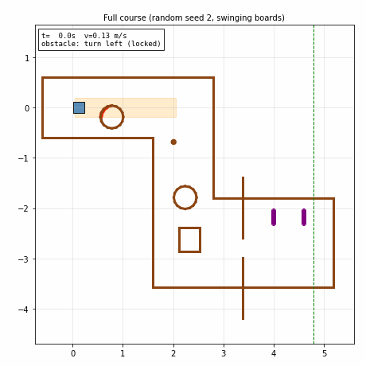

| Narrow zigzag corridor | Reverse-C pocket ahead |
| --- | --- |
| 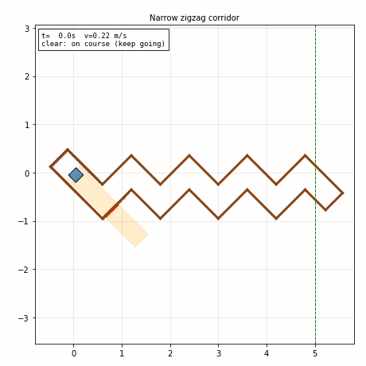 | 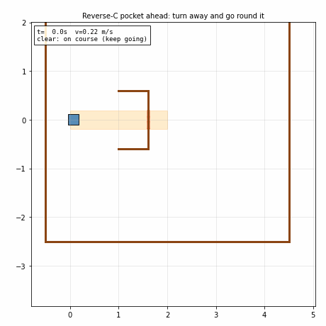 |
| Every corner is a locked turn: the cones pick the side, and the lock holds it until that wall has left the corridor. | The cones see the pocket's closed end and turn away early, then the heading layers take the robot round it. |

## Running

| Where | Command (from the workspace root unless noted) |
| --- | --- |
| Gazebo | `bash src/rb2301_fp/gz_fp.sh` (terminal 1), then `bash src/rb2301_fp/fp.sh` (terminal 2). Each Gazebo launch re-randomises the course (`obstacle_modifier.py`). |
| pocket_test (2-D, no ROS) | From `src/rb2301_fp`: `python3 pocket_test.py` runs every scenario. Name one to run only it (`pocket`, `zigzag`, ...). `random --seed N` runs a randomised course; `--swing` makes the boards hand-swung (decaying); `--real` uses the real robot's speed caps and 720 beams; `--headless --trials 20` gives a success rate. |
| Real robot | On the laptop: `./rsync_fp.sh <robot number>` copies the package to `~/Downloads/rb2301_fp_13` on the robot. On the robot: build with `colb`, start `basecontrol`, `vrpn` and `rplidar`, then `./fp.sh`. |
| Pose check | `./fp.sh --calibrate` prints the OptiTrack and maze poses and never drives. |
| Recorded runs | `python3 sim_runs/make_sim_runs.py` from `src/rb2301_fp`: 20 random courses saved as GIFs marked COMPLETE / TIMEOUT, with a summary in [sim_runs/README.md](rb2301/src/rb2301_fp/sim_runs/README.md) (latest: 15 complete, 5 timeouts, 0 collisions). |
| LiDAR blind zone | `./blindzone_check.sh`: an interactive tool that measures the closest distance the LiDAR can still see. |

## Overview

**Inputs and output**

- LiDAR `/scan` (360 beams in simulation, 720 on the real robot). The LiDAR is mounted facing backwards, 0.114 m ahead of the robot's origin.
- Pose (x, y, heading). In simulation it comes from Gazebo odometry; on the real robot from OptiTrack.
- Output: `cmd_vel` with forward speed and turn rate. `move_2D` caps the speed.

**Frames.** The controller only needs to know which world direction is north.

| Setup | North | East | Goal heading (north-east) |
| --- | --- | --- | --- |
| Simulation | +x (0°) | −y | −45° |
| Real robot (OptiTrack: +x = West, +y = South) | −y (−90°) | −x | −135° |

All the decision logic is written as pure functions with no ROS code (`avoidance_command` and the functions it calls). That way pocket_test runs exactly the same logic as the robot.

**Feature list**

1. Preprocessing
    1. Scan to robot-frame points (LiDAR yaw and offset, invalid returns dropped)
    2. Virtual dead-end walls cast into the scan before preprocessing, after 5 jiggles
    3. Scanned coordinate points sorted by their LiDAR angle (from −180 to 0 to 180°) → to separate objects ↔ gate detection
    4. For the moving-board detection state: scans have a timestamp attached, used to estimate the moving boards' speed and their movement coverage (the motion window in their last 3–6 seconds)
2. Front corridor (main idea): a rectangular corridor 2 m long in front of the robot
    1. Obstacle extraction: grouping close corridor points into obstacles → lock the turn direction for each obstacle, and release the lock when that obstacle has left the corridor (handed over to the next obstacle if there is one)
    2. Speed: slow down if an obstacle is near; too near = back up
3. Case 1: obstacle in the corridor → two side cones, each with sub-cones (number and layout set by parameters)
    1. Two side cones (left, right) decide whether the robot turns left or right
    2. Each side cone has sub-cones that scan for the deepest opening on that side → the deepest sub-cone of each side is compared
    3. The side cone whose opening is closest to North or East gets a bonus score
    4. Cone switch with margin, scan count, cooldown and a slow-down for big switches
    5. Turn rate that grows as the obstacle gets closer
    6. Side check of the area the body sweeps, counter-turn, give-up flip
    7. Back-up with a rear check
    8. Dead-end memory (virtual walls)
4. Case 2: corridor clear (the first layer that applies wins)
    1. Layer 1: already within ±55° of north-east, keep going
    2. Layer 2: north-east open, steer to it
    3. Layer 3: sticky detour toward the open direction closest to North or East
    4. Heading hold with a side check
5. Gate detection
    1. Gap candidates over the whole 360° scan (0.30–0.80 m wide, East–West within 10°)
    2. Through-gap points allowed between the two edges
    3. Wall-end check: long, straight, along the world X or Y axis, end-face skip
    4. Closed-line check
    5. Empty space beyond the gap
    6. Front or back, decided by where the gap is relative to the robot
6. State machine
    1. Gate manoeuvre: APPROACH → ALIGN → TURN → GO
    2. Board crossing: SCAN → SIDE → FACE → APPROACH → WAIT → CROSS, repeated for each board
    3. Fallbacks: gate retry, false gate, timeouts

## Preprocessing

Each scan becomes a set of (x, y) points in the robot frame (x forward, y left). Every later step works on these points or on the raw ranges grouped into cones.

**1. Ranges to points** (`scan_to_robot_points`). Beam *i* has angle θ = angle_min + i × angle_increment + π, where π is added because the LiDAR faces backwards. A beam is dropped if its range is not finite, is below range_min (or 1 cm), or is above range_max. Each remaining beam becomes:

```
x = 0.114 + r·cos θ        y = r·sin θ
```

**2. Virtual walls** (`_with_virtual_walls`). Dead-end walls are stored in the world frame. Before anything else runs, each beam is ray-cast against them (traced out from the LiDAR to see whether it hits one), and its range is shortened if it does. The rest of the controller then sees them as real walls. The scan header is kept, so board timing still works.

**3. Points to obstacles.** The points are grouped differently for each job:

| Use | Points used | Grouping |
| --- | --- | --- |
| Front corridor | Inside the 2.0 m × 0.38 m rectangle ahead | Sorted by bearing across the corridor; split wherever neighbours are more than 0.20 m apart |
| Side cones and heading | Raw ranges, not points | Median range of each narrow cone (no return counts as 6 m) |
| Gate | Whole 360° scan, within 1.2 m | Sorted by bearing seen from the LiDAR; split where the step is over max(0.08 m, 0.04 × range) |
| Boards | World frame, up to 1.6 m ahead and 1.0 m to each side | Sorted by bearing; split at steps over 0.06 m |

Sorting by bearing from the LiDAR, rather than using the raw beam order, matters for two reasons. The backwards LiDAR's beam order wraps around straight ahead. And an object in front of a wall then sits between the two edges of its shadow, so a shadow never looks like a gap.

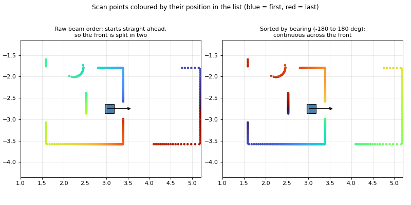

*The same scan points in raw beam order (left) and sorted by bearing (right). Sorted, neighbours in the list are neighbours in the world, so a jump between two points marks a gap or an object edge.*


**4. Time.** Board tracking needs real time between scans. It uses the scan header stamps, because the 20 Hz control loop runs faster than the 10 Hz LiDAR and sees the same scan more than once. Only a new stamp updates the board tracks. pocket_test has no stamps, so it counts 0.1 s per call.

## Main idea: the front corridor

The robot only reacts to what is in a rectangle straight ahead of it: 2.0 m long, and 0.38 m wide (the 0.34 m body plus 2 cm on each side). Anything outside it is ignored for obstacle avoidance. This keeps the robot driving straight past walls and objects beside its path. The nearest obstacle in the rectangle decides whether the robot is in **Case 1 (obstacle)** or **Case 2 (clear)**.

**Finding the obstacle** (`analyse_front_corridor`)

1. Keep the points inside the rectangle and sort them by bearing across it.
2. Split them into separate obstacles wherever two neighbours are more than 0.20 m apart.
3. Drop edge slivers. An obstacle counts only if it reaches at least 20% of the corridor width in from the edge, or crosses the centre line. A wall that just grazes the corridor's edge is ignored.
4. Keep only the obstacle that holds the nearest point. Its distance is `nearest`.
5. Label it. Split the width into 8 bins. If fewer than 80% are occupied, it is a partial block ("left" or "right", by the mean y of its points). Otherwise it is a whole-front block. The label is only the tie-break when the side-cone scores are equal (Case 1).

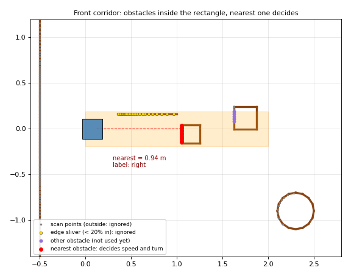

*Only points inside the orange rectangle count. The wall grazing the edge is ignored as a sliver; the nearest obstacle (red) decides the speed and the turn; the one behind it waits its turn.*


**Speed from distance.** The forward speed falls linearly from 0.22 m/s at 0.6 m to 0 at 0.17 m. Below 0.19 m the robot backs up at 0.1 m/s until the obstacle is 0.27 m away (Case 1 below).

**The two cases**

| | Case 1: obstacle | Case 2: clear |
| --- | --- | --- |
| When | Nearest obstacle closer than 0.8 m, or a turn is still locked on an obstacle | Nothing within 0.8 m and no lock |
| Steering | Turn toward the more open side (side cones), locked until that obstacle leaves the corridor | Heading hold toward a goal heading chosen in three layers |
| Speed | Slow down, stop, back up | Speed from distance |

The gate and board state machines (later sections) take over from both cases while they are active.

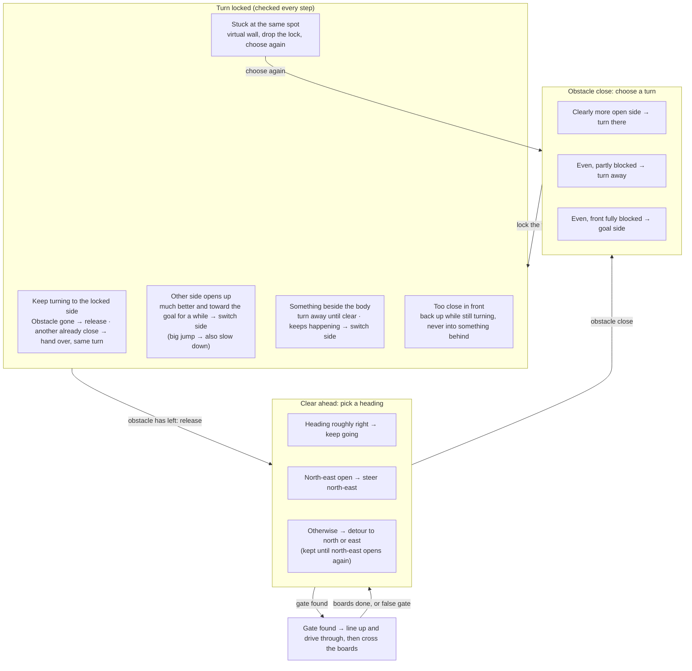

The robot drives clear until an obstacle gets close, chooses a side once, and holds that turn until the obstacle has left. While locked it still checks every step whether to switch side, counter-turn, back up, or mark a dead end.

## Case 1: obstacle in the corridor

When the nearest obstacle is within 0.8 m, the robot picks a turn side once, locks it onto that obstacle, and keeps it until the obstacle leaves the corridor (`_obstacle_avoidance`).

1. **Choosing the side: side cones.** Each side has a search sector centred 40° off straight ahead, ±40° wide. A narrow sub-cone (±7.5°) is stepped across the sector every 15°. A sub-cone's depth is the median range of its beams (no return = 6 m), so one beam through a crack does not count. The side's depth is its deepest sub-cone, so a narrow opening anywhere in the sector is found.

    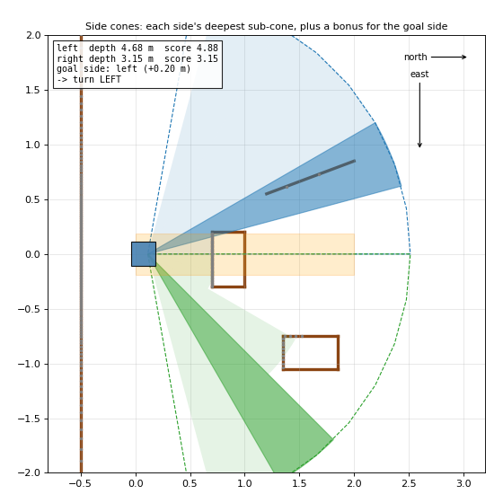

    *Dashed: each side's search sector. Shaded wedges: the sub-cones (length = median depth); the dark one is each side's deepest. The goal side gets the bonus, and the higher score wins.*

2. **Goal-side bonus.** For each side, take the world direction of its deepest sub-cone. Measure its angle to North and to East, and keep the smaller one. The side with the smaller angle is the goal side and gets +0.20 m on its score.
3. **Decision.** Turn toward the higher score. If the scores are within 0.10 m (a tie), a partial block turns away from the obstacle, and a whole-front block turns to the goal side.
4. **Turn lock.** The lock starts when there is no lock and the nearest obstacle is within 0.8 m. It stores the obstacle's points. On the next scan they are rotated by the robot's change in heading, and matched to the new obstacles (same object if within 0.15 m). The lock is released only when that object has no points left in the corridor, not when the corridor is clear. If another obstacle is already within 0.8 m at that moment, the lock is handed over with the same turn direction. This stops the robot swinging back and forth between two obstacles.

    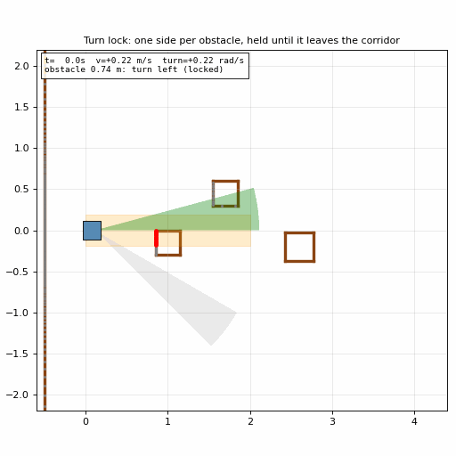

    *Each obstacle gets one turn (green = the side it turns to), held until that obstacle has left the corridor, then the lock is released or handed over.*

5. **Cone switch.** While locked, the other side can take over only if it is the goal side and beats the current side by 0.15 m for 5 scans in a row. A switch is followed by a 20-step cooldown. If the other side won by 0.50 m or more, forward speed is capped at 0.10 m/s for 20 steps. This is a cap, so it has no effect if the robot is already slower.
6. **Turn rate.** The turn rate grows as the obstacle gets closer (the opposite of the speed): 0.15 rad/s at 0.8 m, up to 0.8 rad/s at 0.17 m.
7. **Side check.** The corridor only looks ahead, so a turn could swing the body into something beside it. Turning about the rear axle, a left turn sweeps the front-left and rear-right of the body, and a right turn the front-right and rear-left. If the turn's zone has a point within 0.14 m of the body edge at the front (0.05 m at the rear), the robot turns away from the nearest such point at 1.5 × the turn rate. It returns to its turn once the zone is clear by an extra 0.05 m. The lock keeps its direction meanwhile. If this happens 10 times in one lock, the turn is given up and the lock flips to the counter-turn side.

    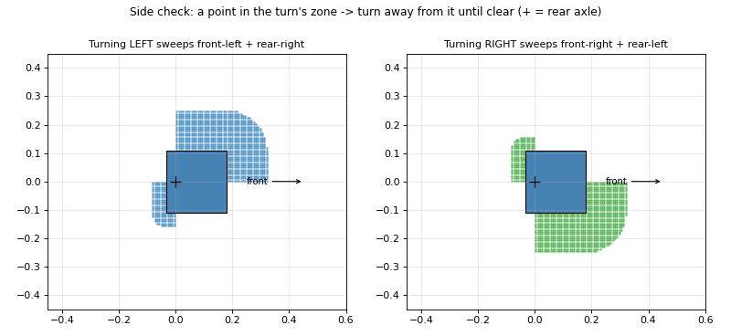

    *The zones a turn sweeps, measured from the body edge. Anything inside the current turn's zone makes the robot turn away until it is clear.*

8. **Back-up.** Below 0.19 m the robot reverses at 0.1 m/s while still turning, until the obstacle is 0.27 m away. It never reverses into anything within 0.10 m behind the body.
9. **Dead-end memory** (`_update_deadends`). Each back-up records where the front of the body was and which way it faced. After 5 back-ups within 0.30 m of each other and facing within 60°, a 0.60 m virtual wall is placed across that spot. The lock is reset so the turn is decided again with the wall in place. At most 10 walls are kept.

    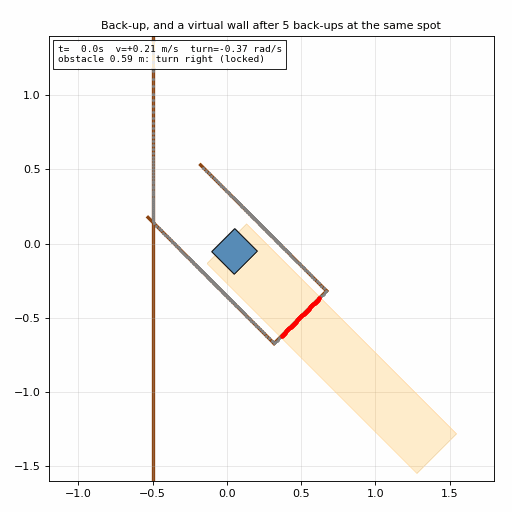

    *In a 0.6 m-wide dead end the robot backs up while turning and tries again. After 5 back-ups at the same spot it places a virtual wall (orange dotted) across it, decides the turn again with the wall in place, and drives out.*


## Case 2: corridor clear

With nothing within 0.8 m and no lock, the robot steers toward a goal heading chosen in three layers (`choose_goal_heading`). The first layer that applies wins.

| Layer | Condition | Heading used | Log label |
| --- | --- | --- | --- |
| 1. On course | Current heading within ±55° of north-east (a 110° window) | Current heading: no steering | on course (keep going) |
| 2. North-east open | The cone toward north-east is at least 1.0 m deep | North-east | north-east |
| 3. Detour | Otherwise | The open direction (1.0 m or more) closest to North or East, among candidates every 15° all round; deeper wins a tie | detour ±N deg |

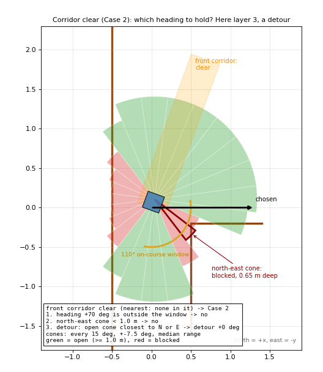

*The front corridor (orange, along the robot's heading) is clear, so the robot is in Case 2 and picks a heading to hold. Each candidate direction is a narrow cone measured by its median range, one every 15° (green = open, red = blocked). Layer 1 fails because the heading (+70°) is outside the 110° window around north-east (gold arc); layer 2 fails because the north-east cone (dark red outline) is blocked by the wall. Layer 3 picks the open cone closest to North or East: due north (black arrow).*


**Why three layers.** Steering straight to north-east all the time turned the robot into walls in narrow places. Layer 1 lets it keep driving along a corridor that already goes roughly the right way. Layer 3 gets it out when north-east is blocked by a wall, instead of pushing into it.

**Sticky detour.** Once chosen, the detour heading is kept until north-east opens again or the detour direction itself gets blocked. Layers 1 and 2 clear it. This stops the detour from jumping between two similar directions on every scan. If nothing is open at all, the target stays north-east and Case 1 handles the obstacle.

**Heading hold.** Turn rate = 0.8 × heading error (rad), capped at 0.8 rad/s. The same side check as in Case 1 runs on this turn too. If the body would sweep into something beside it (for example a wall corner too thin to count in the corridor), the robot turns away from it instead.

## Gate detection

The gate is a gap between the ends of two long, straight walls, with the gap running East–West. Until the gate is passed, `detect_gaps` searches the whole 360° scan for it on every step, using points within 1.2 m. A candidate must pass every check below, in order.

1. **Piece ends.** In the bearing-sorted points, a point is a piece end if the next point is further away than the wall step: max(0.08 m, 0.04 × range). Because beams spread apart with range, the step grows with range too. The array is tripled end to end so that pairs and walks can wrap around ±180°, straight behind the robot.
2. **Pairing.** Edge *a* is a piece end. Edge *b* is the start of a later piece, within 180° of bearing, 0.30–0.80 m from *a*. The robot is 0.22 m wide and the course gate is 0.40 m.
3. **East–West.** The line from *a* to *b* must be within 10° of the East–West axis.
4. **Through-gap points.** Points between *a* and *b* in bearing order are allowed, but only if they are more than 0.30 m beyond the gap line. These are things seen through the opening, such as a cylinder behind the gate.
5. **Wall ends** (`_axis_wall_end`). From each edge, walk away from the gap collecting neighbouring points, up to 0.50 m of wall. The longest straight run (within 1.5 cm of its own best-fit line) is found by binary search. That run must:
    - start within 10 cm of the edge, to skip the wall's end face, which shows as a bent lead-in when seen at a steep angle;
    - have at least 4 points and be at least 0.30 m long;
    - lie within 0.10 m of a world X or Y line through its first point.

    The straightness test rejects cylinders. The longest-straight-run rule stops at a corner where a short gate wall meets another wall.
6. **Closed line** (`_line_closed`). Apart from the gap itself, the gate line must be a solid wall. A point more than 0.20 m beyond the line fails the check if its beam crossed the line outside the gap (with a 3 cm edge margin) and within 1.0 m of the gap centre. Points seen through the gap, such as the boards, are allowed.
7. **Empty beyond.** No point may lie 2–30 cm beyond the gap, between its edges.

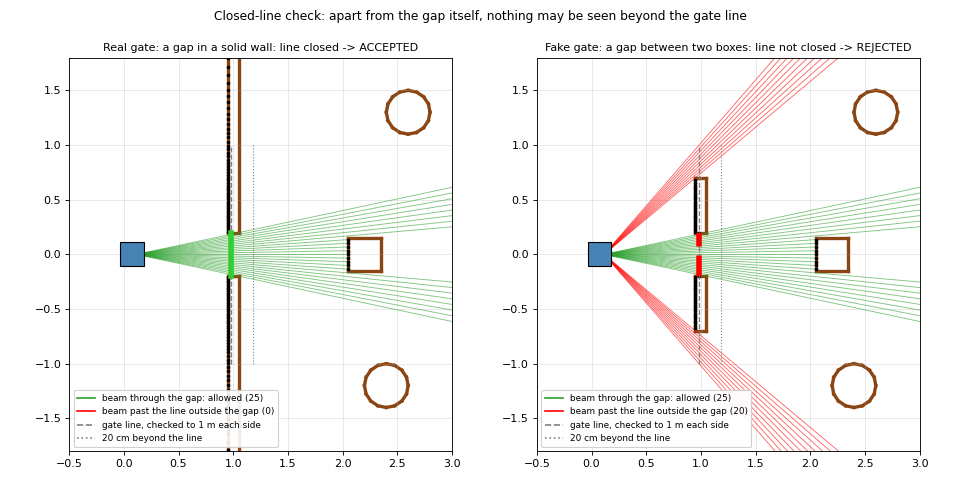

*Closed-line check (check 6). Both openings are 0.4 m wide, run East–West and have straight wall ends, so they pass the other checks. Left: the gap is in a solid wall, so the only beams that reach beyond the gate line pass through the gap (green): accepted. Right: the gap is between two boxes, and beams pass beside the boxes, crossing the line outside the gap within 1 m of its centre (red): the line is not a wall, so it is rejected. With this one check switched off, the two boxes would be taken as the gate.*


**Front or back.** The caller decides this by where the gap centre is, not by which way the robot faces. Let *past* = (robot position − gap centre) · north.

- *past* > 0 (gap south of the robot): **back gate**. The robot is already through, so the board crossing starts at once.
- *past* < 0 (gap north of the robot): **front gate**. The gate manoeuvre starts.

Gaps within 0.60 m of a gap already passed are ignored. Gaps the manoeuvre gave up on are ignored for 200 steps, then tried again.

## Final state machine

The top level has three modes: normal driving (Cases 1 and 2), the gate manoeuvre, and the board crossing. Each step, `_avoidance_core` runs the board crossing if it is active. Otherwise it runs the gate manoeuvre if a front gate is being handled. Otherwise it drives normally.

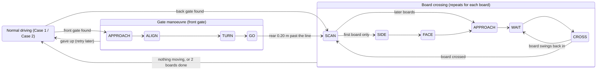

A back gate skips the gate manoeuvre and goes straight to SCAN. If the gate manoeuvre gives up (stalled, timed out, or crossed the line without GO), the robot returns to normal driving and retries that gap 200 steps later.

**Gate manoeuvre (front gate)**

| Phase | What the robot does | Moves on when |
| --- | --- | --- |
| APPROACH | Normal Case 1 avoidance, but aiming at the alignment point: on the gap's centre line, 0.10–0.20 m before the gap | Within 0.20 m of that point with nothing within 0.27 m ahead → ALIGN |
| ALIGN | Steers onto the centre line at 0.15 m/s, slowing for anything ahead | Within 2 cm of the centre line → TURN |
| TURN | Turns on the spot to face through the gap | Facing it within 4° → GO |
| GO | Drives through at 0.25 m/s on the stored gap line; stops if anything is within 0.20 m straight ahead of the body | Body's rear 0.20 m past the gate line → board crossing |

During APPROACH and ALIGN the gap is detected again on each step, and its stored centre and direction are smoothed (70% old, 30% new). During TURN and GO it is not detected again; the stored line is used as it is. The manoeuvre gives up, and retries the gap 200 steps later, if APPROACH gets no 0.05 m closer in 100 steps, if the robot crosses the line without GO, or after 600 steps in total.

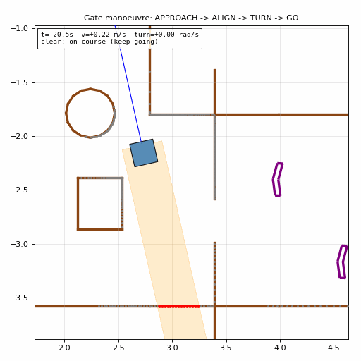

*APPROACH steers to the alignment point on the gap's centre line (dashed), ALIGN lines up on it, TURN faces the gap, and GO drives through on the stored line.*


**Board crossing** (`board_crossing_command`). The boards are swung by hand. Their swing gets slower and shorter over time, and they are not flat. Only the last 6 s of a board's motion are used to judge it.

| Phase | What the robot does | Moves on when |
| --- | --- | --- |
| SCAN | Stands still and tracks board-like clusters (0.05–0.45 m long, at most 0.15 m deep). Detections are grouped into tracks by depth along the travel direction (within 8% of their distance, at least 6 cm). | One track has 15+ detections and 0.20 m+ sideways travel; the nearest is chosen. After 12 s, the nearest track that moved 0.10 m is taken. Nothing moving for 6 s → no more boards. |
| SIDE | Before the first board only: turns to face East and drives at 0.15 m/s | Body front 0.05 m from the east wall, 1.0 m driven, or 15 s → FACE |
| FACE | Turns back to face North | Within 4° → APPROACH |
| APPROACH | Drives straight at up to 0.15 m/s | Body front 0.08 m before the board's near face → WAIT |
| WAIT | Decides when to cross (below) | Safe → CROSS; after 30 s, crosses if the path is clear, otherwise gives up |
| CROSS | Drives straight at 0.4 m/s (capped by `move_2D` on the real robot); goes back to WAIT if the board swings into the path first | Body's rear 0.05 m past the board's far face → SCAN for the next board, or done after 2 boards |

In WAIT, the robot crosses when the board is not in its path (body half-width + 5 cm) and any of these holds:

1. The board has stopped: under 4 cm of travel in the last 3 s.
2. Its swing no longer reaches the path: out of the path and on one side for the whole last 6 s.
3. It is moving away (over 0.03 m/s) toward the longer end of its recent swing.
4. It has not been seen for 2 s, and was last seen at least 0.15 m beside the path.

It waits if the board is moving toward the shorter end, because it will come back soon.

**False gate.** If the first SCAN sees nothing moving, the gate was a false one. The "gate passed" flag is cleared and normal driving resumes, while gate detection keeps looking for the real gate. The false gap stays in the passed list, so it is not taken again.

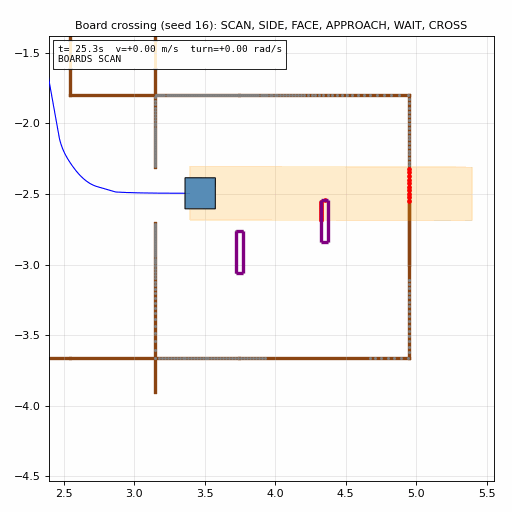

*Seed 16 with full-swing boards, so a board really sweeps across the robot's path. SCAN finds one board's path (magenta dashed), SIDE drives to the east wall, FACE turns north, then APPROACH and WAIT: the robot holds while the board is in front, and crosses as soon as it is moving away toward the longer end of its swing. Then a fresh SCAN for the second board.*


## Iterative optimisation

We developed the controller by running it in pocket_test (randomised courses, swinging boards, the zigzag corridor), in Gazebo and on the real robot, and fixing each failure we saw. The table lists the main changes in the order we made them.

| # | Area | Problem seen in testing | Change |
| --- | --- | --- | --- |
| 1 | Corridor | Reacting to the whole scan made the robot dodge things beside its path | Only the rectangular front corridor is used for avoidance |
| 2 | Corridor | Turns were too slow near obstacles | Turn rate grows as the obstacle gets closer |
| 3 | Corridor | The robot turned back and forth as an obstacle's points changed | Turn lock on the obstacle object, released only when it leaves the corridor |
| 4 | Corridor | It swung between two obstacles in a row | Lock handed over to the next obstacle with the same turn |
| 5 | Corridor | It stopped at v = 0 against a wall and stayed there | Back-up while still turning, with a rear check |
| 6 | Corridor | Turning swung the body into things beside it | Side check of the zones the body sweeps; counter-turn away from the nearest point instead of cancelling the turn |
| 7 | Corridor | The "/" and "\\" angle rules often chose the wrong side | Replaced by side cones: turn toward the deeper side, for every obstacle |
| 8 | Corridor | One deep beam through a crack won a cone | Median range per narrow sub-cone; the side takes its deepest sub-cone |
| 9 | Corridor | The lock kept a bad side after the view opened up | Cone switch only toward the goal side, by a margin, for 5 scans, with a cooldown |
| 10 | Corridor | Wall corners grazing the corridor edge triggered turns | Edge-sliver filter (20% intrusion) |
| 11 | Corridor | It circled in reverse-C pockets | Dead-end memory with virtual walls |
| 12 | Real robot | Wrong goal heading on the real robot | OptiTrack axes (+x = West, +y = South) as constants: north = −90°, north-east = −135° |
| 13 | Gate | Gaps between cylinders were taken as the gate | Wall ends must be straight (1.5 cm) as well as on an X/Y axis |
| 14 | Gate | The gate was missed when it was beside the robot | Front or back decided by the gap's position relative to the robot, not a heading window |
| 15 | Gate | A cylinder seen through the gap broke the edge pairing | Points between the edges allowed if beyond the gap line |
| 16 | Gate | A short gate wall meeting a room wall failed the wall check | Longest straight run kept (binary search); on seed 243890 the gate was crossed at 44 s instead of 103 s |
| 17 | Gate | A box corner plus the wall behind it looked like a gate | Closed-line check: only scans through the gap may go beyond the line |
| 18 | Gate | Looking back, the wall's thickness made the end look bent, so the back gate was found late | The straight run may start up to 10 cm from the edge |
| 19 | Gate | The gap was detected again while driving through, and moved | TURN and GO use the stored gap line; GO ends with the rear 0.20 m past the line |
| 20 | Gate | A false back gate blocked the real one for good | No moving board after the gate → false gate, carry on looking |
| 21 | Boards | The board does not swing fully in front of the robot | Drive to the east wall first (SIDE), where the swing passes once and slows |
| 22 | Boards | The swing decays, so the robot waited forever for the old far end | Only the last 6 s of motion count; also cross if the board stopped or no longer reaches the path |
| 23 | Boards | Waiting for the board to pass in front was slow | Cross as soon as the board is out of the path and moving toward the longer end |
| 24 | Boards | Both boards were tracked at once and mixed up | One board per scan; scan again after each crossing |
| 25 | Boards | APPROACH held for the board forever at the last board | APPROACH only drives to the stop point; WAIT (with its timeouts) decides when to cross |
| 26 | Heading | Cone goal side ignored pure North or East openings | Goal side = smaller of the angles to North and to East |
| 27 | Heading | It pushed into walls toward north-east | Detour toward the open direction closest to North or East, kept until north-east opens |
| 28 | Heading | Big cone switches at speed cut corners | Speed cap of 0.10 m/s for 20 steps after a switch won by 0.50 m |
| 29 | Heading | It kept correcting in corridors that already went the right way | Layer 1: within ±55° of north-east, keep going (110° window) |

## Appendix: key parameters

All values are constants at the top of `obstacle_course.py`, as they stand in the current version.

| Group | Parameter | Value |
| --- | --- | --- |
| Speed | `FORWARD_SPEED` / `BACKUP_SPEED` | 0.22 / 0.1 m/s |
| Speed | `MIN_TURN_SPEED` – `MAX_TURN_SPEED` | 0.15 – 0.8 rad/s |
| Speed | `HEADING_GAIN` | 0.8 rad/s per rad |
| Corridor | `CORRIDOR_LENGTH` × width | 2.0 × 0.38 m |
| Corridor | `SLOWDOWN` / `TURN` / `STOP_DISTANCE` | 0.6 / 0.8 / 0.17 m |
| Corridor | `OBSTACLE_GAP` / `MIN_EDGE_INTRUSION` | 0.20 m / 20% |
| Side cones | Sector centre, half-width, sub-cone, step | 40°, 40°, 7.5°, 15° |
| Side cones | Goal bonus / tie | 0.20 / 0.10 m |
| Side cones | Switch margin, scans, cooldown | 0.15 m, 5, 20 steps |
| Side cones | Big-switch slow-down | ≥ 0.50 m → 0.10 m/s for 20 steps |
| Side check | Front / rear radius, flip count | 0.14 / 0.05 m, 10 |
| Heading | On-course window / open depth | 110° / 1.0 m |
| Dead end | Back-ups, radius, wall width | 5, 0.30 m, 0.60 m |
| Gate | Detect range / width | 1.2 m / 0.30–0.80 m |
| Gate | E–W alignment / axis tolerance | 10° / 0.10 m |
| Gate | Wall min length / straightness / end skip | 0.30 m / 1.5 cm / 10 cm |
| Gate | Closed-line depth / extent | 0.20 / 1.0 m |
| Gate manoeuvre | Standoff / align tolerance / GO speed | 0.10–0.20 m / 2 cm / 0.25 m/s |
| Gate manoeuvre | GO past line / max steps / retry | 0.20 m / 600 / 200 steps |
| Boards | Scan depth × half-width | 1.6 × 1.0 m |
| Boards | Confident track | 15 detections, 0.20 m travel |
| Boards | Recent window / none-found time / wait timeout | 6 s / 6 s / 30 s |
| Boards | Side drive / approach / cross speed | 0.15 / 0.15 / 0.4 m/s |
