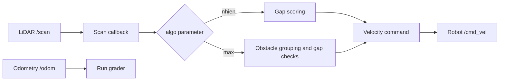

# RB2301 CA1 - Reactive Obstacle Avoidance

This ROS 2 package controls an omnidirectional nano-car through an unknown field of cylindrical obstacles. The robot has no pre-built map: it repeatedly reads a 360-degree LiDAR scan, chooses a safe movement direction, and publishes a velocity command.

The package contains **two independent obstacle-avoidance algorithms** in [`obstacle_avoidance.py`](rb2301_ca1/obstacle_avoidance.py):

- `nhien` - scores open regions in the LiDAR scan and moves towards the best one.
- `max` - groups LiDAR returns into obstacles, checks whether the robot fits through the gaps between them, and moves towards a safe gap.

The algorithms share the ROS 2 node, subscriber, publisher, timer, and motion helper, but their decision-making logic is separate. Select either algorithm with the `algo` launch argument.

## Quick start

### Requirements

- Ubuntu with ROS 2 Jazzy
- Gazebo Harmonic
- `ros-jazzy-ros-gz`
- Python 3 with NumPy
- The accompanying [`rb2301_gz`](../rb2301_gz) package

From the workspace directory containing `src/`:

```bash
source /opt/ros/jazzy/setup.bash
colcon build --symlink-install
source install/setup.bash
```

Run Nhien's algorithm in a reproducible random world:

```bash
ros2 launch rb2301_ca1 ca1.launch.py \
  algo:=nhien scenario:=random random_seed:=1
```

Run Max's algorithm in the **same** world by reusing the seed:

```bash
ros2 launch rb2301_ca1 ca1.launch.py \
  algo:=max scenario:=random random_seed:=1
```

Press `Ctrl+C` to stop the simulation.

### Launch arguments

| Argument | Accepted values | Purpose |
| --- | --- | --- |
| `algo` | `nhien`, `max` | Selects the obstacle-avoidance algorithm. |
| `scenario` | `random`, `front_left`, `front_right`, `diagonal_left` | Selects a random or fixed obstacle layout. Default: `random`. |
| `random_seed` | Any integer | Recreates the same random layout for fair comparisons. |

`algo` and `random_seed` must be provided. The seed affects only the `random` scenario.

## How the package works



The `ObstacleAvoidanceNode`:

1. subscribes to `/scan` and stores a reduced LiDAR scan;
2. runs at 20 Hz and calls the algorithm selected by the `algo` parameter;
3. clips translational commands to +/-0.4 m/s and rotational commands to +/-0.8 rad/s; and
4. publishes a `geometry_msgs/Twist` command on `/cmd_vel`.

Because the nano-car is omnidirectional, both algorithms can command forward/backward motion and lateral motion without first turning the robot.

## Algorithm 1: `nhien`

Nhien's algorithm treats obstacle avoidance as a circular gap-search problem. It can choose an arbitrary direction instead of considering only front, left, and right.

### Decision process

1. **Prepare the scan.** Every second LiDAR reading is retained, and distances are clipped to the range 0-20 m.
2. **Estimate map boundaries.** Very large regions at the sensor limit may represent space outside the obstacle field rather than a useful route. A moving window detects these regions and assigns them a decaying score based on their angular width. This biases the robot back towards the course.
3. **Apply directional consistency.** The rear sector is masked. Temporary left/right masks are also used after close side obstacles are detected, helping the robot continue around L-shaped configurations instead of immediately reversing its decision.
4. **Find gaps.** The scan is duplicated to make the 0/360-degree boundary continuous. A moving window expands across readings of at least 0.5 m.
5. **Score gaps.** A candidate must satisfy the minimum angular width and mean-distance checks. Its score combines gap width and mean clearance.
6. **Move towards the winner.** The centre angle of the highest-scoring gap is converted into forward and lateral velocity components.
7. **Apply emergency reactions.** Obstacles closer than 0.15 m can force a lateral escape or cancel forward motion.

In short, `nhien` asks: **Which sufficiently open direction has the strongest combination of width and distance?**

## Algorithm 2: `max`

Max's algorithm reasons about obstacle geometry. It identifies separate cans, constructs candidate gaps between adjacent cans, and checks whether the robot can safely travel to a gap.

### Decision process

1. **Prepare the front scan.** Every fourth LiDAR reading is retained and converted from polar ranges into `(x, y)` points within the front 180-degree field of view.
2. **Check the forward corridor.** If no point blocks the 0.30 m forward corridor, the robot travels straight at 0.30 m/s. After avoidance, eight clear control cycles are required before normal forward movement resumes.
3. **Group obstacle returns.** Consecutive points are treated as the same can unless their indices are discontinuous or their separation exceeds 0.12 m.
4. **Construct candidate gaps.** The inner edges of each pair of neighbouring cans define a gap and its midpoint. Candidates outside +/-85 degrees are ignored.
5. **Check robot clearance.** The robot width is 0.23 m with a 0.05 m margin on each side, so a gap must provide at least 0.33 m of lateral clearance. A swept-corridor check also rejects a route if a nearer obstacle blocks the diagonal translation to the midpoint.
6. **Choose a gap.** A nearly straight gap is preferred. Otherwise, the algorithm selects the closest-to-forward safe gap on its preferred side and moves towards its midpoint at 0.18 m/s.
7. **Use the fallback layer.** If no valid gap remains, the robot compares median clearance on both sides and sidesteps towards the clearer one. If that side is blocked, it switches side and holds the new choice for 12 cycles; if necessary, it reverses slightly.

In short, `max` asks: **Can the robot physically fit through this gap, and is the entire route to it clear?**

## Comparison

Both algorithms were evaluated on the same five seeded random layouts.

| Algorithm | Runs completed | Success rate | Mean simulated time | Mean path length |
| --- | ---: | ---: | ---: | ---: |
| `nhien` | 5/5 | 100% | 19.86 s | 7.5598 m |
| `max` | 5/5 | 100% | 26.00 s | 7.249 m |

Under these test conditions, `nhien` completed the course faster, while `max` produced a slightly shorter path. The algorithms use different movement speeds, so completion time is not a direct measure of path-selection quality alone.

## Evaluation and test scenarios

The launch file starts three main components together:

- `obstacle_avoidance` - runs the selected controller;
- `rb2301_gz` - generates the selected obstacle world and starts Gazebo; and
- `algo_grader` - uses `/odom` to measure elapsed simulation time and planar path length until the robot crosses the finish line.

Use the fixed scenarios for specific behaviours:

```bash
# L-shaped layouts
ros2 launch rb2301_ca1 ca1.launch.py algo:=nhien scenario:=front_left random_seed:=0
ros2 launch rb2301_ca1 ca1.launch.py algo:=max scenario:=front_right random_seed:=0

# Diagonal corridor
ros2 launch rb2301_ca1 ca1.launch.py algo:=max scenario:=diagonal_left random_seed:=0
```

For algorithm comparisons, keep `scenario` and `random_seed` unchanged and change only `algo`.

## Repository contents

| Path | Description |
| --- | --- |
| [`rb2301_ca1/obstacle_avoidance.py`](rb2301_ca1/obstacle_avoidance.py) | Shared ROS 2 node and both independent algorithms. |
| [`rb2301_ca1/obstacle_generator.py`](rb2301_ca1/obstacle_generator.py) | Seeded random-world and fixed edge-case generation. |
| [`rb2301_ca1/algo_grader.py`](rb2301_ca1/algo_grader.py) | Measures completion time and travelled path length. |
| [`launch/ca1.launch.py`](launch/ca1.launch.py) | Starts the controller, simulation, and grader. |
| [`RB2301_CA1_Nhien_A0325663B.pdf`](RB2301_CA1_Nhien_A0325663B.pdf) | Detailed report for the `nhien` algorithm. |
| [`RB2301_CA1_Maxwell_A0323869N.pdf`](RB2301_CA1_Maxwell_A0323869N.pdf) | Detailed report for the `max` algorithm. |
| [`CA1_Simulation.mp4`](CA1_Simulation.mp4) | Simulation demonstration. |
| [`CA1_Real_Life_Test.mp4`](CA1_Real_Life_Test.mp4) | Physical robot demonstration. |

## Team

- Maxwell Timothy Ebora Guico
- Suda Jesmitha Reddy
- Nguyen Linh Nhien
