# rb2301_fp: Final Project Obstacle Course

ROS 2 (Jazzy) package for the RB2301 final project (Group 13). The controller drives the Bingda robot across the obstacle course toward north-east using only the LiDAR scan and the robot's pose. It avoids obstacles with a front corridor and side cones, finds and drives through the gate, then crosses two swinging boards. The same code runs in Gazebo, in the 2-D test simulator (`pocket_test.py`) and on the real robot.

For the full design (corridor, gate detection, state machine, tuning), see [FP.md](../../../FP.md). To run everything in simulation, see [HOW_TO_RUN.md](../../../HOW_TO_RUN.md).

## Reports

Each group member wrote an individual report on the project:

| Report | Author |
| --- | --- |
| [RB2301_FP_Nguyen Linh Nhien_A0325663B.pdf](RB2301_FP_Nguyen%20Linh%20Nhien_A0325663B.pdf) | Nguyen Linh Nhien |
| [RB2301_FP_Group 13_Maxwell_Guico_A0323869N.pdf](RB2301_FP_Group%2013_Maxwell_Guico_A0323869N.pdf) | Maxwell Guico |
| [RB2301_FP_Suda_Jesmitha_Reddy_A0321806L.pdf](RB2301_FP_Suda_Jesmitha_Reddy_A0321806L.pdf) | Suda Jesmitha Reddy |

Videos: [GazeboSim.mp4](GazeboSim.mp4) (Gazebo run) and [RealRun.mp4](RealRun.mp4) (real robot).

## Package contents

| File | What it is |
| --- | --- |
| `rb2301_fp/obstacle_course.py` | The controller (node `obstacle_course`) |
| `rb2301_fp/obstacle_modifier.py` | Re-randomises the Gazebo course on every launch |
| `rb2301_fp/blindzone_check.py` | Interactive tool that measures the LiDAR blind zone |
| `rb2301_fp/optitrack_variables.config` | OptiTrack / maze pose settings for the real robot |
| `pocket_test.py` | 2-D simulator that runs the real controller against a fake LiDAR (no ROS needed) |
| `sim_runs/` | 20 recorded random-course runs (GIFs) and the script that makes them |
| `gz_fp.sh`, `fp.sh`, `blindzone_check.sh` | Launch scripts (run from the workspace root) |

## Build and run

From the workspace root (the `rb2301/` folder that holds `src/`):

```bash
source /opt/ros/jazzy/setup.bash
colcon build --symlink-install
chmod +x src/rb2301_fp/*.sh
```

| Where | Command |
| --- | --- |
| Gazebo | `bash src/rb2301_fp/gz_fp.sh` (terminal 1), then `bash src/rb2301_fp/fp.sh` (terminal 2). Each launch re-randomises the course. |
| Real robot | On the laptop: `./rsync_fp.sh <robot number>`. On the robot: build with `colb`, start `basecontrol`, `vrpn` and `rplidar`, then `./fp.sh`. |
| Pose check | `./fp.sh --calibrate` prints the OptiTrack and maze poses without driving. |
| LiDAR blind zone | `bash src/rb2301_fp/blindzone_check.sh` (needs a `/scan` topic). |

## pocket_test (2-D simulator)

`pocket_test.py` runs the exact same controller (`avoidance_command` in `obstacle_course.py`) against a ray-cast fake LiDAR in 2-D worlds. It animates the robot, its front corridor, its side cones and the scan points. It is the quickest way to try a change, and it needs only Python with `numpy` and `matplotlib` (no ROS).

Run it from this folder (`src/rb2301_fp`):

```bash
python3 pocket_test.py                  # every scenario, one after another
python3 pocket_test.py pocket           # one scenario
python3 pocket_test.py random           # a new randomised final-project course
python3 pocket_test.py random --seed 7  # the same random course every time
python3 pocket_test.py random --swing   # boards swing like hand-pushed pendulums
python3 pocket_test.py --no-anim        # only draw the final paths
python3 pocket_test.py random --seed 0 --trials 20 --headless   # success rate over 20 courses, no plots
```

| Scenario | What it tests |
| --- | --- |
| `box_right`, `box_left` | A box on one side of the corridor; the robot should turn away from it |
| `perpendicular`, `slash`, `backslash` | A wall across the path, square or angled |
| `pocket`, `pocket_deep` | Reverse-C pockets (dead ends) |
| `course` | A mixed course heading north-east |
| `zigzag` | A narrow zigzag corridor |
| `fp_course` | The course from the last Gazebo `gz_fp.sh` launch |
| `random` | A randomised final-project course (gate, cylinders, boards), same randomisation as `obstacle_modifier.py` |

| Option | Effect |
| --- | --- |
| `--seed N` | Fix the random course (with `random`) |
| `--trials N` | Run N random courses starting from the seed |
| `--swing` | Hand-swung, decaying boards instead of motorised ones |
| `--real` | Real-robot speed caps (0.5 m/s, 1.0 rad/s) and a 720-beam scan |
| `--no-anim` | Skip the animation, only draw the final paths |
| `--headless` | Print results only, no windows |

**Animation controls.** Slider, plus Play/Pause, Rewind, Stop, step and speed buttons. Keys: `space` play/pause, `←`/`→` step, `r` rewind, `s` stop. Close the window to move on to the next scenario.

**Result line.** Each run prints `FINISHED in Ns`, `COLLISION`, `STUCK` or `ok`, with the distance travelled and the first turn. With `--trials`, a final line gives the totals.

## Sim runs: 20 randomised courses

`python3 sim_runs/make_sim_runs.py` (from this folder) runs 20 random courses in pocket_test with hand-swung boards and a 240 s limit. It skips courses where the robot spawns on an obstacle, and saves each run as a GIF named with its result. Options: `--runs N`, `--first-seed N`, `--motorised`. The full table is in [sim_runs/README.md](sim_runs/README.md).

**Result: 15 COMPLETE, 5 TIMEOUT, 0 COLLISION.** Completed runs took 40–66 s (mean 51 s). Seeds 10, 12, 15 and 20 were rejected (robot spawned on an obstacle).

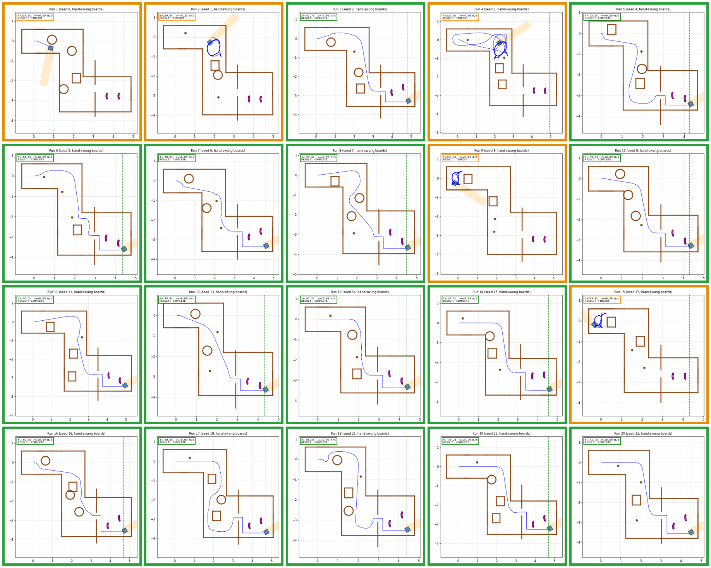

*Final frame of every run: green frame = COMPLETE, orange = TIMEOUT.*

| | | | |
| --- | --- | --- | --- |
| 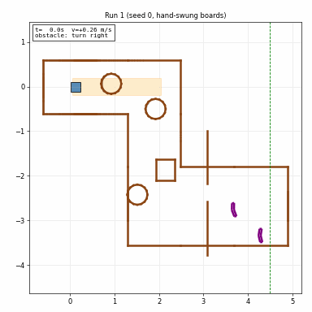<br>Run 1, seed 0: TIMEOUT | 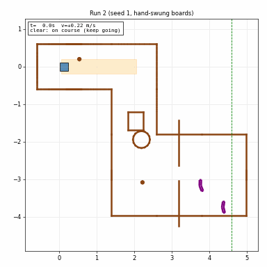<br>Run 2, seed 1: TIMEOUT | 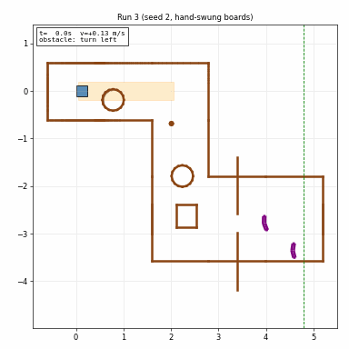<br>Run 3, seed 2: COMPLETE (42.7 s) | 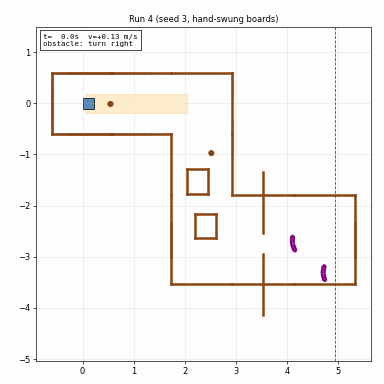<br>Run 4, seed 3: TIMEOUT |
| 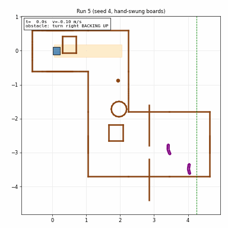<br>Run 5, seed 4: COMPLETE (55.9 s) | 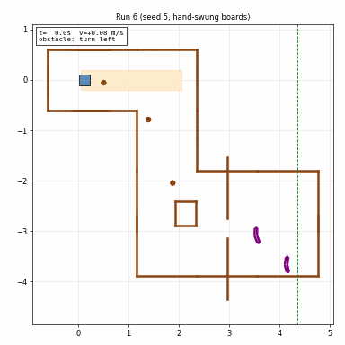<br>Run 6, seed 5: COMPLETE (64.5 s) | 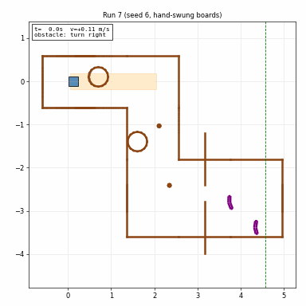<br>Run 7, seed 6: COMPLETE (50.6 s) | 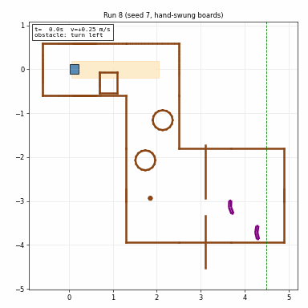<br>Run 8, seed 7: COMPLETE (57.4 s) |
| 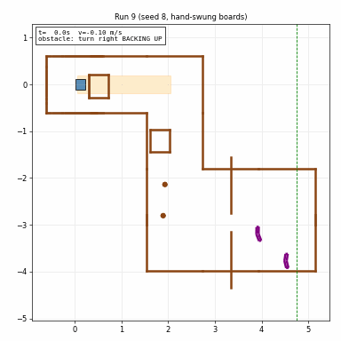<br>Run 9, seed 8: TIMEOUT | 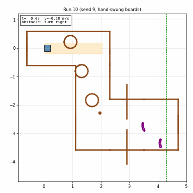<br>Run 10, seed 9: COMPLETE (39.8 s) | 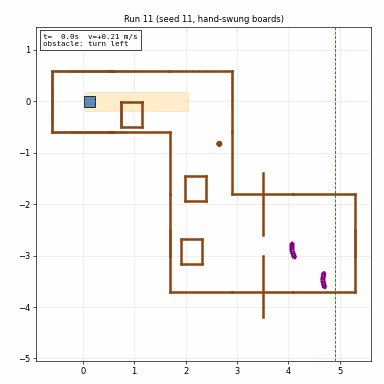<br>Run 11, seed 11: COMPLETE (46.5 s) | 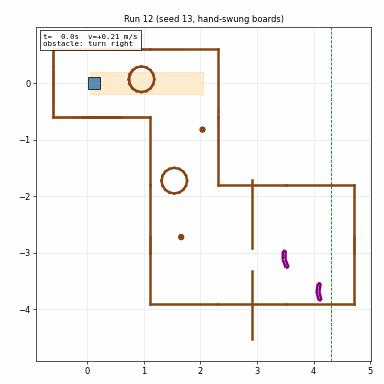<br>Run 12, seed 13: COMPLETE (44.0 s) |
| 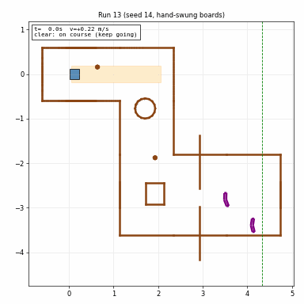<br>Run 13, seed 14: COMPLETE (47.7 s) | 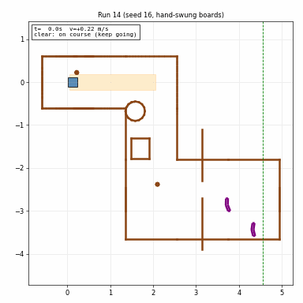<br>Run 14, seed 16: COMPLETE (42.7 s) | 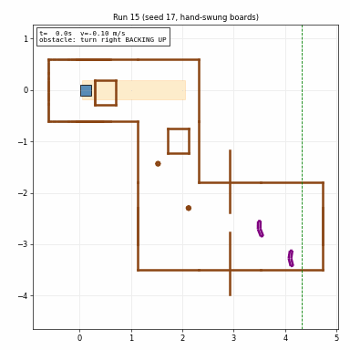<br>Run 15, seed 17: TIMEOUT | 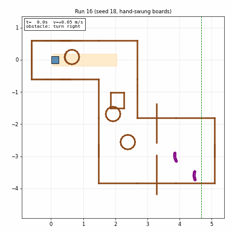<br>Run 16, seed 18: COMPLETE (58.8 s) |
| 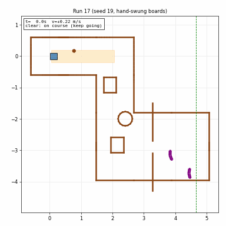<br>Run 17, seed 19: COMPLETE (60.8 s) | 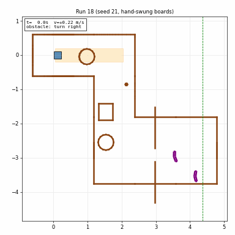<br>Run 18, seed 21: COMPLETE (66.4 s) | 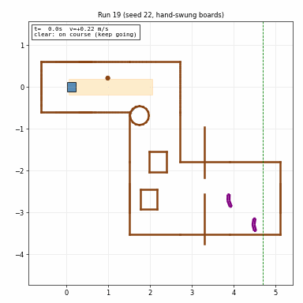<br>Run 19, seed 22: COMPLETE (45.2 s) | 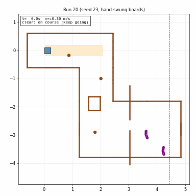<br>Run 20, seed 23: COMPLETE (42.7 s) |

All five timeouts are slow orbits that the turn lock and dead-end memory do not catch. Seed 0 gets stuck beside a cylinder near the start. Seeds 8 and 17 circle in the west end of the start room. Seeds 1 and 3 circle at the corner where the course turns south.

To replay any run interactively in pocket_test, use its seed: `python3 pocket_test.py random --seed 2 --swing`.
