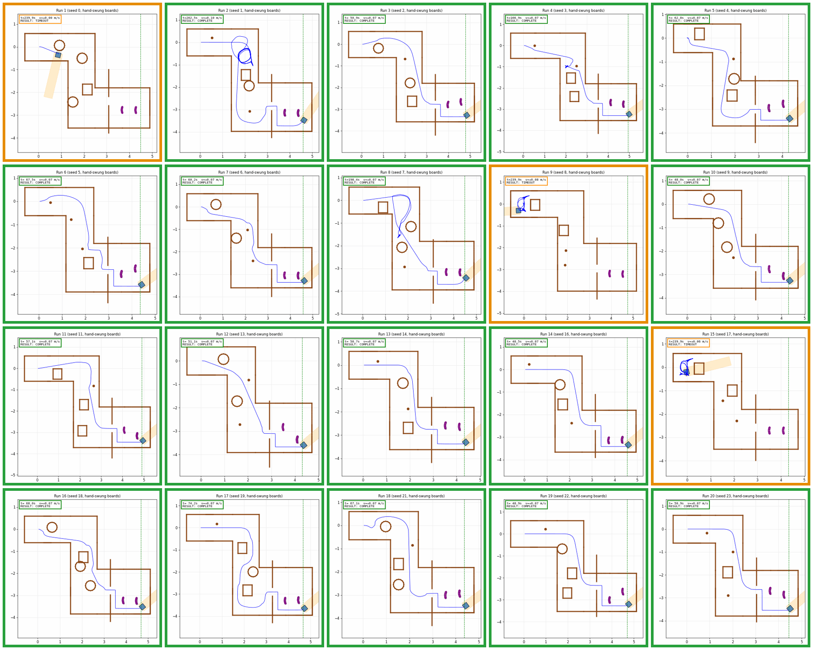

# pocket_test: 20 randomised runs

Randomised final-project courses (same randomisation as `obstacle_modifier.py`) with hand-swung boards, run by the real controller in `pocket_test.py`. Time limit 240 s per run.

*Final frame of every run: green frame = COMPLETE, orange = TIMEOUT, red = COLLISION.*

| Result | Runs |
| --- | --- |
| COMPLETE | 17 |
| TIMEOUT | 3 |
| COLLISION | 0 |

Completed runs took 48–202 s (mean 81 s).

Rejected (robot spawned on top of an obstacle): seeds 10, 12, 15, 20.

| Run | Seed | Result | Time (s) | Distance (m) | Gate passed at (s) | Animation |
| --- | --- | --- | --- | --- | --- | --- |
| 1 | 0 | **TIMEOUT** | 239.9 | 0.9 | - | [run_01_seed_0_TIMEOUT.gif](run_01_seed_0_TIMEOUT.gif) |
| 2 | 1 | **COMPLETE** | 202.5 | 24.1 | 165.5 | [run_02_seed_1_COMPLETE.gif](run_02_seed_1_COMPLETE.gif) |
| 3 | 2 | **COMPLETE** | 50.9 | 7.4 | 31.6 | [run_03_seed_2_COMPLETE.gif](run_03_seed_2_COMPLETE.gif) |
| 4 | 3 | **COMPLETE** | 166.9 | 8.9 | 126.3 | [run_04_seed_3_COMPLETE.gif](run_04_seed_3_COMPLETE.gif) |
| 5 | 4 | **COMPLETE** | 62.8 | 8.0 | 41.3 | [run_05_seed_4_COMPLETE.gif](run_05_seed_4_COMPLETE.gif) |
| 6 | 5 | **COMPLETE** | 67.5 | 7.6 | 26.7 | [run_06_seed_5_COMPLETE.gif](run_06_seed_5_COMPLETE.gif) |
| 7 | 6 | **COMPLETE** | 60.2 | 7.0 | 38.9 | [run_07_seed_6_COMPLETE.gif](run_07_seed_6_COMPLETE.gif) |
| 8 | 7 | **COMPLETE** | 198.4 | 14.3 | 7.5 | [run_08_seed_7_COMPLETE.gif](run_08_seed_7_COMPLETE.gif) |
| 9 | 8 | **TIMEOUT** | 239.9 | 11.8 | - | [run_09_seed_8_TIMEOUT.gif](run_09_seed_8_TIMEOUT.gif) |
| 10 | 9 | **COMPLETE** | 48.0 | 6.6 | 27.0 | [run_10_seed_9_COMPLETE.gif](run_10_seed_9_COMPLETE.gif) |
| 11 | 11 | **COMPLETE** | 57.1 | 8.1 | 9.7 | [run_11_seed_11_COMPLETE.gif](run_11_seed_11_COMPLETE.gif) |
| 12 | 13 | **COMPLETE** | 51.1 | 6.6 | 29.6 | [run_12_seed_13_COMPLETE.gif](run_12_seed_13_COMPLETE.gif) |
| 13 | 14 | **COMPLETE** | 58.7 | 7.0 | 37.3 | [run_13_seed_14_COMPLETE.gif](run_13_seed_14_COMPLETE.gif) |
| 14 | 16 | **COMPLETE** | 48.5 | 7.3 | 25.3 | [run_14_seed_16_COMPLETE.gif](run_14_seed_16_COMPLETE.gif) |
| 15 | 17 | **TIMEOUT** | 239.9 | 13.6 | - | [run_15_seed_17_TIMEOUT.gif](run_15_seed_17_TIMEOUT.gif) |
| 16 | 18 | **COMPLETE** | 68.0 | 7.2 | 46.9 | [run_16_seed_18_COMPLETE.gif](run_16_seed_18_COMPLETE.gif) |
| 17 | 19 | **COMPLETE** | 74.2 | 9.9 | 51.9 | [run_17_seed_19_COMPLETE.gif](run_17_seed_19_COMPLETE.gif) |
| 18 | 21 | **COMPLETE** | 67.1 | 8.1 | 47.8 | [run_18_seed_21_COMPLETE.gif](run_18_seed_21_COMPLETE.gif) |
| 19 | 22 | **COMPLETE** | 48.9 | 7.3 | 25.3 | [run_19_seed_22_COMPLETE.gif](run_19_seed_22_COMPLETE.gif) |
| 20 | 23 | **COMPLETE** | 50.9 | 7.2 | 28.2 | [run_20_seed_23_COMPLETE.gif](run_20_seed_23_COMPLETE.gif) |

Re-run: `python3 sim_runs/make_sim_runs.py` from `rb2301/src/rb2301_fp` (see the script for options).
